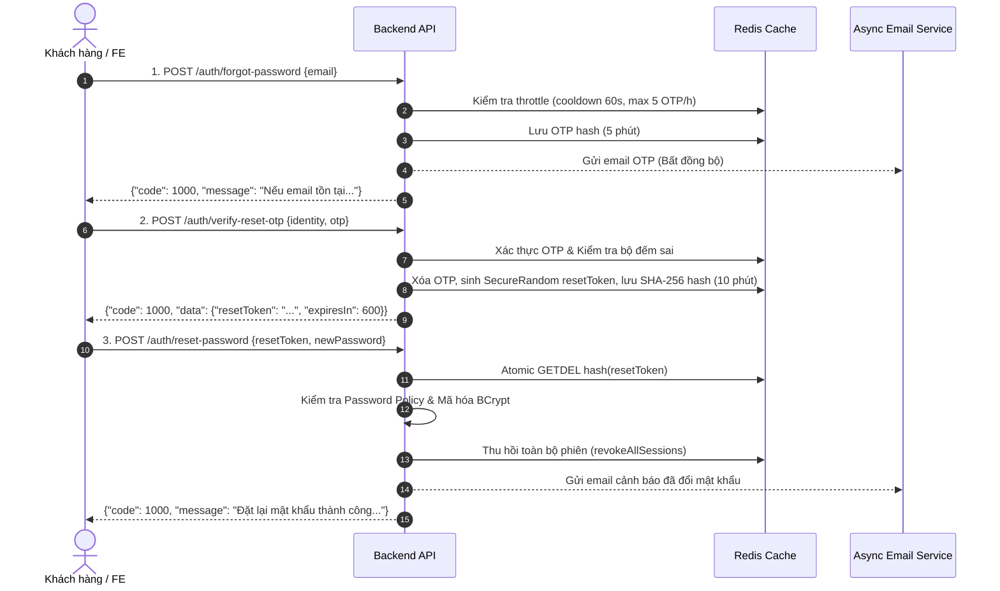
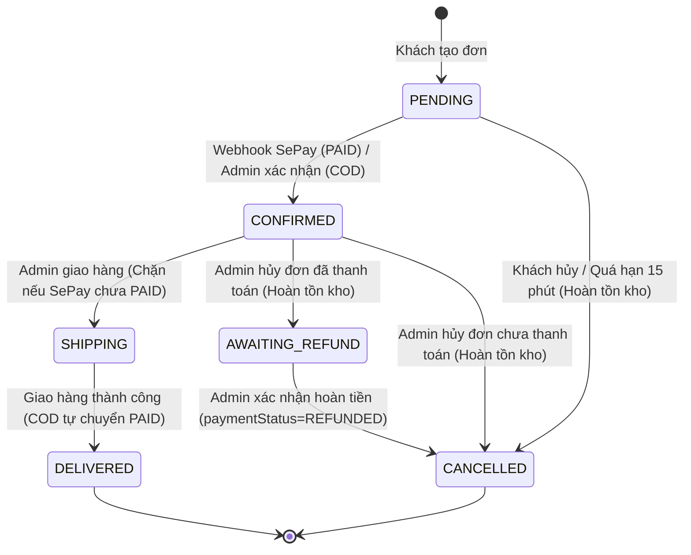

# TÀI LIỆU BÀN GIAO API CHO FRONTEND (ANDROID & NEXT.JS)

> **Dự án**: BE_E-Commerce (Spring Boot 3.3.4, Java 21, MongoDB Atlas, Redis)  
> **Phiên bản API**: `v1`  
> **Base Path**: `/api/v1`  
> **Đối tượng sử dụng**: Mobile Engineer (Android) & Frontend Engineer (Next.js)

---

## 1. QUY CHUẨN GIAO TIẾP VÀ CẤU TRÚC PHẢN HỒI

Mọi API phản hồi đều tuân theo cấu trúc JSON đồng nhất:

### 1.1. Phản hồi thành công (`ApiResponse<T>`)
```json
{
  "code": 1000,
  "message": "Thông điệp thành công",
  "data": { ... }
}
```

### 1.2. Phản hồi phân trang (`PageResponse<T>`)
Khi `data` là dữ liệu danh sách có phân trang:
```json
{
  "code": 1000,
  "message": "Thành công",
  "data": {
    "items": [ ... ],
    "pageNo": 0,
    "pageSize": 15,
    "totalElements": 42,
    "totalPages": 3,
    "last": false
  }
}
```
> [!NOTE]
> - Tham số phân trang gửi lên: `page` (bắt đầu từ `0`) và `size` (mặc định 15, **giới hạn trần cứng [1, 50]** để chống DoS tràn RAM).
> - Backend tự động giới hạn nếu client gửi `size > 50` về `50`, và `page < 0` về `0`.

### 1.3. Phản hồi lỗi (`AppException` / `GlobalExceptionHandler`)
```json
{
  "code": 5004,
  "error": "PAYMENT_METHOD_NOT_SUPPORTED",
  "message": "Phương thức thanh toán ví điện tử MOMO hiện chưa được tích hợp."
}
```

---

## 2. XÁC THỰC, TÀI KHOẢN & OTP (AUTH FLOW)

### 2.1. Quy chuẩn Mật khẩu & Dữ liệu Đầu vào (Password Policy & Validation)
Hệ thống áp dụng chính sách bảo mật mật khẩu và dữ liệu chuẩn hóa toàn diện cho các luồng Register, Reset Password và Change Password:
- **Mật khẩu**: Độ dài bắt buộc từ **8 đến 64 ký tự**, tối đa **72 byte UTF-8** (đảm bảo an toàn thuật toán BCrypt).
- **Chống lộ thông tin**: Mật khẩu **không được trùng hoặc chứa địa chỉ email**.
- **Chặn mật khẩu phổ biến**: Từ chối các mật khẩu quá dễ đoán (nằm trong danh sách top 100+ mật khẩu phổ biến nhất như `12345678`, `password123`...).
- **Đổi mật khẩu (`change-password`)**: Bắt buộc mật khẩu mới **phải khác mật khẩu hiện tại**.
- **Họ và tên (`fullName`)**: 2 đến 100 ký tự.
- **Email**: Tối đa 254 ký tự, hệ thống tự động chuẩn hóa (`trim()` và chuyển thành chữ thường `toLowerCase()`) trước khi lưu và truy vấn.
- **Số điện thoại (`phone`)**: Nếu có, bắt buộc phải đúng định dạng di động Việt Nam: `^(0|\+84)(3|5|7|8|9)\d{8}$` (10 chữ số với đầu 0 hoặc 11 ký tự với +84).

### 2.2. Luồng Đăng ký & Kích hoạt qua OTP (Register & Verification Flow)
1. **Đăng ký tài khoản**: `POST /api/v1/auth/register`
   - **Body**:
     ```json
     {
       "email": "customer@gmail.com",
       "password": "Password123@",
       "fullName": "Nguyễn Văn A",
       "phone": "0987654321"
     }
     ```
   - **Cơ chế**: Tài khoản được tạo với trạng thái `isActive = false`, `emailVerified = false`. Hệ thống sinh mã OTP 6 chữ số (hiệu lực **5 phút**) và gửi bất đồng bộ vào email của người dùng.
   - **Đăng ký lại tài khoản chưa kích hoạt**: Nếu người dùng đăng ký lại bằng email của tài khoản chưa kích hoạt (`isActive == false && emailVerified == false`), hệ thống sẽ cập nhật thông tin họ tên, số điện thoại, mật khẩu mới và cấp OTP mới (tuân theo cooldown), không bị chặn lỗi email đã tồn tại. Nếu email đã kích hoạt, hệ thống trả HTTP 409 (`USER_ALREADY_EXISTS` - mã `1004`).
   - **Lưu ý**: Nếu tài khoản chưa kích hoạt gọi `POST /api/v1/auth/login`, API trả lỗi HTTP 400 (`USER_NOT_ACTIVATED` - mã `1017`) sau khi đã xác thực mật khẩu chính xác.

2. **Xác thực OTP kích hoạt**: `POST /api/v1/auth/verify-account` hoặc `POST /api/v1/auth/verify-otp`
   - **Body**:
     ```json
     {
       "email": "customer@gmail.com",
       "otp": "123456"
     }
     ```
   - **Thành công**: Tài khoản chuyển sang `isActive = true`, `emailVerified = true`. Người dùng có thể tiến hành đăng nhập.
   - **Chống Brute-Force & Tiết lộ thông tin**:
     - Sai quá **5 lần** cho một mã OTP: Mã OTP sẽ bị xóa ngay lập tức.
     - Sai quá **10 lần/giờ** cho một email: Khóa luồng OTP của email đó trong **1 giờ** (trả HTTP 429 - `OTP_MAX_ATTEMPTS_EXCEEDED` mã `1011`).
     - Phản hồi đồng nhất: Nếu tài khoản không tồn tại hoặc đã kích hoạt mà nhập OTP sai, API đều trả chung lỗi HTTP 400 `INVALID_OTP` (mã `1016`), tuyệt đối không tiết lộ tài khoản tồn tại hay trạng thái kích hoạt.

3. **Gửi lại OTP kích hoạt (Public)**: `POST /api/v1/auth/resend-verification-otp`
   - **Body**:
     ```json
     {
       "email": "customer@gmail.com"
     }
     ```
   - **Đặc điểm**: Endpoint công khai không cần token đăng nhập, dùng khi người dùng chưa nhận được email kích hoạt.
   - **Bảo mật phản hồi**: Luôn trả thông điệp thành công đồng nhất `{"code": 1000, "message": "Nếu email tồn tại và chưa kích hoạt, mã OTP mới đã được gửi thành công"}` bất kể email có tồn tại hay không.
   - **Rate Limit**: Tối đa 3 request/phút/IP (fail-closed HTTP 503 khi Redis lỗi). Giới hạn cooldown 60 giây giữa các lần nhận OTP và tối đa 5 OTP/giờ theo email (`OTP_THROTTLED` - mã `1010`).

4. **Gửi lại OTP (Authenticated)**: `POST /api/v1/auth/send-verification-otp`
   - Dành cho phiên người dùng đã có token đăng nhập cần xác thực lại email. Áp dụng chung giới hạn cooldown 60 giây và tối đa 5 OTP/giờ.

### 2.3. Đăng nhập & Quản lý Phiên (Login & Session Management)
1. **Đăng nhập**: `POST /api/v1/auth/login`
   - **Body**:
     ```json
     {
       "email": "customer@gmail.com",
       "password": "Password123@"
     }
     ```
   - **Response**: Trả về `accessToken` (JWT thời hạn ngắn), `refreshToken` (thời hạn 7 ngày, lưu Redis whitelist), thông tin `user`.
   - **Chống Timing Attack & Trích xuất thông tin (Anti-Enumeration)**:
     - Hệ thống luôn kiểm tra mật khẩu trước (chạy giả lập hashing nếu user không tồn tại để cân bằng thời gian thực thi).
     - Sai mật khẩu hoặc email không tồn tại đều trả về cùng lỗi HTTP 401 (`INVALID_CREDENTIALS` - mã `1005`).
     - Chỉ khi mật khẩu ĐÚNG, hệ thống mới kiểm tra trạng thái tài khoản: `USER_NOT_ACTIVATED` (mã `1017`) hoặc `USER_BLOCKED` (mã `1018`).
   - **Khóa tạm thời chống Brute-Force (`ACCOUNT_TEMP_LOCKED` - mã `1014`, HTTP 429)**:
     - Sai quá **5 lần trong 15 phút** từ cùng một cặp (Email + IP).
     - Sai quá **20 lần trong 15 phút** trên cùng một Email từ các IP khác nhau.
     - Khi bị khóa tạm, hệ thống từ chối đăng nhập trong 15 phút. Đăng nhập thành công sẽ tự động đặt lại bộ đếm sai.

2. **Làm mới token (Refresh Token)**: `POST /api/v1/auth/refresh-token`
   - **Body**:
     ```json
     {
       "refreshToken": "..."
     }
     ```
   - **Response**: Cấp cặp token mới (`accessToken` và `refreshToken` xoay vòng).
   - **Bảo mật Xoay vòng & Phát hiện Token Bị đánh cắp (Theft Detection)**:
     - Mỗi refresh token chỉ được sử dụng đúng một lần và bị thu hồi nguyên tử (`atomic delete`).
     - Token cũ được đưa vào danh sách kiểm soát `used-refresh` trong 7 ngày. Nếu một refresh token cũ được gửi lại (dấu hiệu bị attacker đánh cắp và gửi lại sau khi user thật đã refresh), hệ thống lập tức phát hiện nguy cơ và **thu hồi toàn bộ phiên đăng nhập của người dùng trên mọi thiết bị** ngay lập tức (`INVALID_TOKEN` - mã `1007`).

3. **Đăng xuất (Logout)**: `POST /api/v1/auth/logout`
   - **Header**: `Authorization: Bearer <accessToken>` (chấp nhận cả access token đã hết hạn để người dùng luôn đăng xuất được).
   - **Body (Tùy chọn)**:
     ```json
     {
       "refreshToken": "..."
     }
     ```
   - **Hành vi**:
     - Nếu gửi kèm `refreshToken`: Chỉ thu hồi đúng phiên đăng nhập / thiết bị tương ứng với refresh token đó.
     - Nếu không gửi body hoặc `refreshToken` rỗng: Thu hồi toàn bộ phiên đăng nhập của người dùng trên mọi thiết bị.
     - Access token hiện tại luôn được đưa vào blacklist trên Redis.

4. **Đăng xuất tất cả thiết bị (Logout All)**: `POST /api/v1/auth/logout-all`
   - **Header**: `Authorization: Bearer <accessToken>`.
   - **Hành vi**: Xóa toàn bộ refresh token và ghi nhận mốc thời gian khóa phiên trên Redis, vô hiệu hóa ngay lập tức mọi token đã được cấp trước đó trên toàn bộ thiết bị.

### 2.4. Luồng Quên & Đặt lại Mật khẩu (Forgot & Reset Password - Flow 2 Bước Mới)
> [!IMPORTANT]
> **BREAKING CHANGE**: Luồng đặt lại mật khẩu đã được chuyển đổi hoàn toàn sang mô hình 2 bước có `resetToken` dùng 1 lần, loại bỏ việc truyền trực tiếp OTP vào API đặt lại mật khẩu.

> [!CAUTION]
> **QUY TẮC BẮT BUỘC CHO FRONTEND (NEXT.JS & ANDROID)**:
> - Màn hình quên mật khẩu **chỉ được chuyển sang bước đặt mật khẩu mới khi nhận được `resetToken` từ API `POST /api/v1/auth/verify-reset-otp`**.
> - **Tuyệt đối KHÔNG DÙNG `/api/v1/auth/verify-otp` (hoặc `/verify-account`) cho luồng này!** API `/api/v1/auth/verify-otp` CHỈ dành riêng cho bước kích hoạt tài khoản đăng ký mới. Nếu gọi `/api/v1/auth/verify-otp`, client sẽ không nhận được `resetToken` và API đặt lại mật khẩu (`POST /api/v1/auth/reset-password`) sẽ từ chối hoàn toàn với lỗi HTTP 400.



1. **Bước 1: Yêu cầu OTP quên mật khẩu**: `POST /api/v1/auth/forgot-password`
   - **Body**:
     ```json
     {
       "email": "customer@gmail.com"
     }
     ```
     *(Lưu ý: Chỉ chấp nhận trường `email`, không hỗ trợ `channel` hay SMS).*
   - **Response**: Luôn trả về phản hồi đồng nhất:
     ```json
     {
       "code": 1000,
       "message": "Nếu email tồn tại trong hệ thống, mã OTP đặt lại mật khẩu đã được gửi."
     }
     ```
   - Email được gửi qua tiến trình bất đồng bộ (`@Async`), đảm bảo thời gian phản hồi API đồng đều bất kể email có tồn tại hay không.

2. **Bước 2: Xác thực OTP để lấy `resetToken`**: `POST /api/v1/auth/verify-reset-otp` *(Endpoint mới)*
   - **Body**:
     ```json
     {
       "identity": "customer@gmail.com",
       "otp": "123456"
     }
     ```
   - **Response thành công**:
     ```json
     {
       "code": 1000,
       "message": "Xác thực OTP thành công. Vui lòng sử dụng mã resetToken để đổi mật khẩu.",
       "data": {
         "resetToken": "A_SECURE_RANDOM_32_BYTES_BASE64URL_STRING",
         "expiresIn": 600
       }
     }
     ```
   - `resetToken` có thời hạn **10 phút (600 giây)**. Mỗi người dùng chỉ có tối đa 1 `resetToken` có hiệu lực tại một thời điểm (yêu cầu mới sẽ thay thế token cũ).
   - Rate limit: 5 request/phút/IP (fail-closed HTTP 503 khi Redis lỗi).

3. **Bước 3: Đổi mật khẩu mới**: `POST /api/v1/auth/reset-password`
   - **Body**:
     ```json
     {
       "resetToken": "A_SECURE_RANDOM_32_BYTES_BASE64URL_STRING",
       "newPassword": "NewPassword123@"
     }
     ```
     *(Lưu ý: Bỏ hoàn toàn trường `identity` và `otp`).*
   - **Response**:
     ```json
     {
       "code": 1000,
       "message": "Đặt lại mật khẩu thành công. Vui lòng đăng nhập lại."
     }
     ```
   - `resetToken` bị tiêu thụ nguyên tử (atomic get-and-delete), chỉ sử dụng được **đúng 1 lần**.
   - Toàn bộ phiên đăng nhập cũ trên mọi thiết bị bị thu hồi ngay lập tức (`revokeAllSessions`).
   - Hệ thống tự động gửi email thông báo bảo mật đến người dùng: "Mật khẩu tài khoản của bạn vừa được thay đổi thành công".

---

## 3. SẢN PHẨM & DANH MỤC (PRODUCTS & CATEGORIES)

### 3.1. Phía Khách hàng (Public)
- `GET /api/v1/public/products`: Danh sách sản phẩm đang bán (`active: true`), hỗ trợ tìm kiếm từ khóa, khoảng giá, phân loại, thương hiệu.
- `GET /api/v1/public/products/{id}`:
  > [!WARNING]
  > Nếu sản phẩm đã bị Admin ẩn (`active == false`), API trả về **HTTP 404** (`PRODUCT_NOT_FOUND` - mã `3001`). Frontend cần hiển thị thông báo "Sản phẩm không tồn tại hoặc đã ngừng kinh doanh" thay vì để crash.

### 3.2. Phía Quản trị viên (Admin - Yêu cầu Role ADMIN)
- `GET /api/v1/admin/products`: Xem danh sách toàn bộ sản phẩm (kèm cờ lọc `active=true|false`).
- `GET /api/v1/admin/products/{id}`: Xem chi tiết sản phẩm bất kỳ.
- `PATCH /api/v1/admin/products/{id}/status`: Bật/tắt trạng thái ẩn hiện:
  ```json
  { "active": false }
  ```

---

## 4. GIỎ HÀNG, ĐẶT HÀNG & THANH TOÁN (ORDER & PAYMENT)

### 4.1. Lựa chọn phương thức thanh toán khả dụng
Trước khi hiển thị trang thanh toán (Checkout), FE gọi API:
- `GET /api/v1/payment/methods` (hoặc `/api/v1/payments/methods`)
- **Response**:
  ```json
  {
    "code": 1000,
    "message": "Lấy danh sách phương thức thanh toán thành công",
    "data": [
      {
        "code": "COD",
        "name": "Thanh toán khi nhận hàng (COD)",
        "description": "Thanh toán bằng tiền mặt khi nhận hàng",
        "enabled": true
      },
      {
        "code": "SEPAY",
        "name": "Chuyển khoản VietQR tự động qua SePay",
        "description": "Quét mã VietQR chuyển khoản ngân hàng, hệ thống xác nhận thanh toán tự động trong vài giây",
        "enabled": true
      }
    ]
  }
  ```

> [!IMPORTANT]
> **Quyết định D1 đã chốt**: Chỉ hỗ trợ **COD** và **SEPAY**.
> Nếu gửi `MOMO`, `VNPAY` hoặc `BANKING` lên API Checkout, hệ thống sẽ từ chối với lỗi HTTP 400 (`PAYMENT_METHOD_NOT_SUPPORTED` - mã `5004`).

### 4.2. Đặt hàng (Checkout)
- `POST /api/v1/orders`
- **Body**:
  ```json
  {
    "customerName": "Nguyễn Văn A",
    "customerEmail": "customer@gmail.com",
    "customerPhone": "0987654321",
    "shippingAddress": {
      "fullName": "Nguyễn Văn A",
      "phone": "0987654321",
      "province": "Hà Nội",
      "district": "Cầu Giấy",
      "ward": "Dịch Vọng",
      "streetAddress": "Số 123 Cầu Giấy"
    },
    "paymentMethod": "SEPAY",
    "note": "Giao giờ hành chính"
  }
  ```
- **Response**: Trả về `OrderResponse`:
  - `status`: `PENDING`
  - `paymentStatus`: `UNPAID`
  - Nếu `paymentMethod == "SEPAY"`, response trả kèm thông tin VietQR:
    - `qrImageUrl`: Link ảnh VietQR chuẩn SePay (chứa sẵn số tài khoản, số tiền, cú pháp chuyển khoản).
    - `bankName`, `accountNumber`, `accountHolder`, `transferContent` (`orderCode`).

### 4.3. Quản lý Đơn hàng & Cơ chế Đếm ngược Quá hạn (D3, D5, D6)
1. **Thời gian giữ đơn (D3)**:
   - Các đơn hàng `SEPAY` chưa thanh toán (`UNPAID`) có thời hạn thanh toán là **15 phút**.
   - Frontend hiển thị đồng hồ đếm ngược 15 phút. Khi hết hạn, đơn hàng sẽ được backend tự động hủy và hoàn lại số lượng tồn kho (`status: CANCELLED`).
2. **Kiểm tra trạng thái thanh toán**:
   - `GET /api/v1/payment/status/{orderId}`
   - **Response**:
     ```json
     {
       "code": 1000,
       "data": {
         "orderId": "...",
         "orderCode": "BETES12345678",
         "paymentStatus": "PAID",
         "finalAmount": 250000,
         "paidAmount": 250000,
         "amountDiscrepancy": 0,
         "isOverpaid": false,
         "isUnderpaid": false,
         "isPaid": true,
         "isCancelled": false,
         "message": "Đơn hàng đã được thanh toán đầy đủ."
       }
     }
     ```
   - **Khách chuyển thiếu (D5)**: `isUnderpaid = true`, `paymentStatus` vẫn là `UNPAID`. Khách hàng có thể quét mã tiếp tục chuyển phần tiền còn lại trước khi hết 15 phút. Khi tổng số tiền tích lũy đủ `finalAmount`, đơn tự động sang `PAID` và `CONFIRMED`.
   - **Khách chuyển thừa (D6)**: `isOverpaid = true`, `amountDiscrepancy > 0`. Đơn hàng vẫn được duyệt `PAID` và `CONFIRMED` để kịp thời đóng gói, phần tiền thừa được ghi nhận để Admin hoàn tiền thủ công.

### 4.4. Hủy đơn hàng và Hoàn tiền (D4, D7)
1. **Khách hàng tự hủy**: `PUT /api/v1/orders/{id}/cancel` (chỉ được hủy khi `status == PENDING` và `paymentStatus == UNPAID`).
2. **Admin giao hàng (D4)**:
   - Đơn `SEPAY` chưa `PAID` mà Admin bấm chuyển sang `SHIPPING` sẽ bị hệ thống **chặn hoàn toàn** với lỗi HTTP 400 (`PAYMENT_REQUIRED_BEFORE_SHIPPING` - mã `5005`).
3. **Admin hủy đơn đã thanh toán (D7)**:
   - Nếu Admin bấm hủy đơn hàng đã `PAID`, đơn hàng chuyển sang trạng thái `AWAITING_REFUND`, tồn kho lập tức được hoàn lại.
   - Khi Admin đã chuyển khoản hoàn tiền cho khách, Admin gọi API `PATCH /api/v1/admin/orders/{id}/confirm-refund` để hoàn tất chuyển sang `CANCELLED` và `paymentStatus: REFUNDED`.

---

## 5. MÁY TRẠNG THÁI ĐƠN HÀNG (ORDER STATE MACHINE)



---

## 6. QUẢN TRỊ ADMIN APIS (ROLE_ADMIN)

### 6.1. Quản lý Người dùng
- `GET /api/v1/admin/users`: Tìm kiếm theo từ khóa tên/email/sđt, lọc theo `role`, `active`, phân trang.
- `GET /api/v1/admin/users/{userId}`: Chi tiết hồ sơ kèm `totalOrders` và `totalSpent` (chuẩn D9).
- `PATCH /api/v1/admin/users/{userId}/status`: Khóa (`active: false`) hoặc mở khóa (`active: true`).
- `PATCH /api/v1/admin/users/{userId}/roles`: Cập nhật vai trò (`["ROLE_CUSTOMER", "ROLE_ADMIN"]`).

### 6.2. Tra cứu & Chi tiết Đơn hàng
- `GET /api/v1/admin/orders`: Lọc theo `keyword` (mã đơn, sđt, email), `status`, `paymentStatus`, `paymentMethod`, `from`, `to`, `sortBy`, `sortDir`.
- `GET /api/v1/admin/orders/{id}`: Chi tiết đơn hàng kèm toàn bộ lịch sử giao dịch SePay liên quan.

### 6.3. Đối soát Giao dịch SePay
- `GET /api/v1/admin/payments/transactions`: Danh sách giao dịch SePay (lọc theo `status: PROCESSED | MISMATCH | FAILED | DUPLICATE`).
- `PATCH /api/v1/admin/payments/transactions/{id}/process`: Xử lý giao dịch lỗi/lệch tiền thủ công:
  ```json
  {
    "action": "RESOLVED",
    "adminNote": "Đã đối soát thủ công và hoàn tiền mặt cho khách"
  }
  ```

### 6.4. Thống kê & Báo cáo Doanh thu (Chuẩn D9)
- `GET /api/v1/admin/statistics/overview?from=...&to=...`: Tổng quan doanh thu, số đơn, người dùng mới, số sản phẩm sắp hết hàng.
- `GET /api/v1/admin/statistics/revenue?groupBy=day|month&from=...&to=...`: Dữ liệu vẽ biểu đồ doanh thu.
- `GET /api/v1/admin/statistics/top-products?limit=10`: Top sản phẩm bán chạy.
- `GET /api/v1/admin/statistics/low-stock?threshold=10`: Danh sách sản phẩm tồn kho thấp cần nhập thêm hàng.

### 6.5. Upload Đa phương tiện
- `POST /api/v1/media/upload`: Upload 1 ảnh (`file`).
- `POST /api/v1/media/upload-multiple`: Upload nhiều ảnh (`files`).
> [!NOTE]
> Bắt buộc phải có quyền `ROLE_ADMIN` để upload ảnh.

---

## 7. BẢNG MÃ LỖI HỆ THỐNG (ERROR CODES)

| Mã lỗi | Enum Name | HTTP Status | Ý nghĩa & Hướng xử lý trên giao diện |
| :--- | :--- | :---: | :--- |
| `1000` | `SUCCESS` | 200 / 201 | Thao tác thành công. |
| `1001` | `UNAUTHENTICATED` | 401 | Chưa đăng nhập hoặc token đã hết hạn / bị thu hồi -> Chuyển về màn hình đăng nhập. |
| `1002` | `UNAUTHORIZED` / `ACCESS_DENIED` | 403 | Không có quyền truy cập chức năng này (ví dụ: Customer cố gọi API Admin). |
| `1003` | `VALIDATION_ERROR` | 400 | Dữ liệu gửi lên không đúng định dạng (thiếu trường, sai regex, rỗng...). |
| `1004` | `USER_ALREADY_EXISTS` | 409 | Email này đã được đăng ký trong hệ thống. |
| `1005` | `INVALID_CREDENTIALS` | 401 | Email hoặc mật khẩu không chính xác. |
| `1006` | `TOKEN_EXPIRED` | 401 | Access token hết hạn -> Gọi API `refresh-token`. |
| `1007` | `INVALID_TOKEN` | 401 | Token không hợp lệ. |
| `1010` | `OTP_THROTTLED` | 429 | Yêu cầu gửi OTP quá nhanh (cooldown 60s hoặc trần 5 OTP/giờ). Vui lòng thử lại sau. |
| `1011` | `OTP_MAX_ATTEMPTS_EXCEEDED` | 429 | Nhập sai OTP quá 10 lần/giờ. Luồng OTP của email bị khóa tạm thời trong 1 giờ. |
| `1012` | `AUTH_SERVICE_UNAVAILABLE` | 503 | Dịch vụ xác thực tạm thời không khả dụng do lỗi hạ tầng (Redis). Vui lòng thử lại sau. |
| `1013` | `RESET_TOKEN_INVALID` | 400 | Mã đặt lại mật khẩu không hợp lệ, đã hết hạn (10 phút) hoặc đã được sử dụng. |
| `1014` | `ACCOUNT_TEMP_LOCKED` | 429 | Tài khoản tạm thời bị khóa do đăng nhập sai nhiều lần (5 lần/IP hoặc 20 lần/email). Thử lại sau 15 phút. |
| `1016` | `INVALID_OTP` | 400 | Mã OTP không đúng hoặc đã hết hạn (quá 5 phút). |
| `1017` | `USER_NOT_ACTIVATED` | 400 | Tài khoản chưa xác thực OTP email -> Chuyển sang màn hình nhập OTP. |
| `1018` | `USER_BLOCKED` | 403 | Tài khoản đã bị khóa bởi Quản trị viên. |
| `3001` | `PRODUCT_NOT_FOUND` | 404 | Không tìm thấy sản phẩm (hoặc sản phẩm đang bị ẩn). |
| `3002` | `INSUFFICIENT_STOCK` | 400 | Sản phẩm không đủ số lượng trong kho khi đặt hàng. |
| `4001` | `ORDER_NOT_FOUND` | 404 | Đơn hàng không tồn tại hoặc không thuộc quyền sở hữu của user (IDOR prevention). |
| `4002` | `ORDER_CANNOT_BE_CANCELLED` | 400 | Đơn hàng không ở trạng thái PENDING/UNPAID để hủy. |
| `4004` | `INVALID_ORDER_STATUS_TRANSITION`| 400 | Chuyển đổi trạng thái đơn hàng không hợp lệ theo quy trình. |
| `4005` | `ORDER_ALREADY_REFUNDED` | 400 | Đơn hàng đã được hoàn tiền trước đó. |
| `5001` | `PAYMENT_FAILED` | 400 | Xử lý thanh toán thất bại. |
| `5004` | `PAYMENT_METHOD_NOT_SUPPORTED` | 400 | Phương thức thanh toán chưa được hỗ trợ (chỉ chấp nhận COD và SEPAY). |
| `5005` | `PAYMENT_REQUIRED_BEFORE_SHIPPING`| 400 | Đơn SEPAY chưa thanh toán (PAID), không thể chuyển sang giao hàng. |
| `9001` | `TOO_MANY_REQUESTS` | 429 | Thao tác quá nhanh, vượt giới hạn Rate Limit (vui lòng thử lại sau 1 phút). |
| `9999` | `INTERNAL_SERVER_ERROR` | 500 | Lỗi hệ thống máy chủ, vui lòng thử lại sau. |


---

## 8. DANH SÁCH BREAKING CHANGES CHO FRONTEND & MOBILE (ĐỢT GIA CỐ AUTH)

Các kỹ sư Frontend (Next.js) và Mobile (Android) cần lưu ý điều chỉnh các điểm sau để tích hợp tương thích với API mới:

| TT | Khu vực / Endpoint | Thay đổi cũ | Thay đổi mới (Bắt buộc tuân theo) | Lý do bảo mật & Lưu ý |
| :-: | :--- | :--- | :--- | :--- |
| **1** | `POST /auth/reset-password` | Nhận `{identity, otp, newPassword}` | Nhận `{resetToken, newPassword}` | Chuyển sang mô hình 2 bước: Client phải gọi `POST /auth/verify-reset-otp` trước để lấy `resetToken` (10 phút), sau đó mới gọi reset password. |
| **2** | `POST /auth/verify-reset-otp` | *Chưa có* | **Endpoint mới**: Nhận `{identity, otp}`, trả `{resetToken, expiresIn: 600}` | Dùng để đổi mã OTP lấy `resetToken` dùng 1 lần. |
| **3** | `POST /auth/forgot-password` | Nhận `{identity, channel}` | **Chỉ nhận `{email}`** | Bỏ trường `channel` và SMS do chưa hỗ trợ. Email gửi ngầm async. |
| **4** | `POST /auth/logout` | Không có body | Có thể gửi body tùy chọn `{"refreshToken": "..."}` | Nếu gửi `refreshToken`, backend chỉ hủy đúng thiết bị hiện tại; nếu không gửi thì hủy toàn bộ thiết bị. |
| **5** | `POST /auth/resend-verification-otp` | *Chưa có* | **Endpoint công khai mới**: Nhận `{"email": "..."}` | Không cần đăng nhập vẫn gửi lại được OTP kích hoạt. Luôn trả HTTP 200 message thành công đồng nhất. |
| **6** | Chính sách mật khẩu | `min=6`, không trần, không check yếu | Bắt buộc **8 - 64 ký tự**, tối đa **72 byte UTF-8**, không trùng email, không nằm trong top mật khẩu phổ biến | Cần validate trên form FE trước khi submit để tránh người dùng bị backend từ chối. |
| **7** | `POST /auth/verify-otp` | Trả `true` nếu user đã active | Luôn trả lỗi HTTP 400 `INVALID_OTP` nếu OTP sai, bất kể user đã active hay chưa | Chống rò rỉ trạng thái người dùng (enumeration). |
