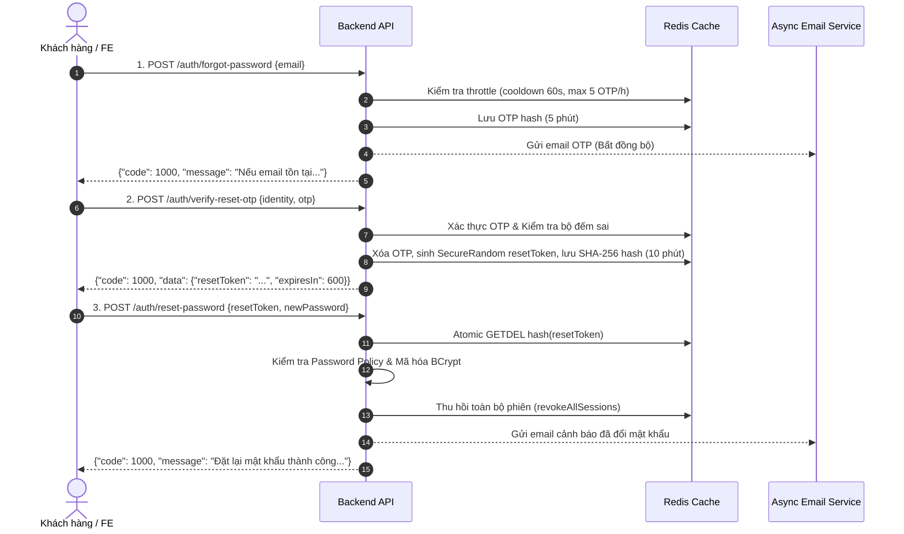
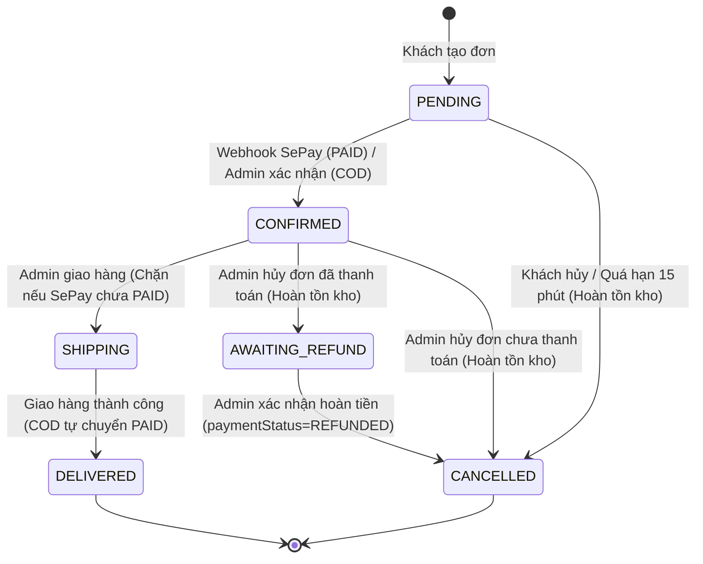

# TÀI LIỆU BÀN GIAO API CHO FRONTEND (ANDROID & NEXT.JS)

> **Dự án**: BE_E-Commerce (Spring Boot 3.3.4, Java 21, MongoDB Atlas, Redis)  
> **Phiên bản API**: `v1`  
> **Base Path**: `/api/v1`  
> **Đối tượng sử dụng**: Mobile Engineer (Android) & Frontend Engineer (Next.js)

---

## 1. QUY CHUẨN GIAO TIẾP VÀ CẤU TRÚC PHẢN HỒI

Mọi API phản hồi đều tuân theo cấu trúc JSON đồng nhất:

### 1.1. Phản hồi thành công (`ApiResponse<T>`)
```json
{
  "code": 1000,
  "message": "Thông điệp thành công",
  "data": { ... }
}
```

### 1.2. Phản hồi phân trang (`PageResponse<T>`)
Khi `data` là dữ liệu danh sách có phân trang:
```json
{
  "code": 1000,
  "message": "Thành công",
  "data": {
    "items": [ ... ],
    "pageNo": 0,
    "pageSize": 15,
    "totalElements": 42,
    "totalPages": 3,
    "last": false
  }
}
```
> [!NOTE]
> - Tham số phân trang gửi lên: `page` (bắt đầu từ `0`) và `size` (mặc định 15, **giới hạn trần cứng [1, 50]** để chống DoS tràn RAM).
> - Backend tự động giới hạn nếu client gửi `size > 50` về `50`, và `page < 0` về `0`.

### 1.3. Phản hồi lỗi (`AppException` / `GlobalExceptionHandler`)
```json
{
  "code": 5004,
  "error": "PAYMENT_METHOD_NOT_SUPPORTED",
  "message": "Phương thức thanh toán ví điện tử MOMO hiện chưa được tích hợp."
}
```

---

## 2. XÁC THỰC, TÀI KHOẢN & OTP (AUTH FLOW)

### 2.1. Quy chuẩn Mật khẩu & Dữ liệu Đầu vào (Password Policy & Validation)
Hệ thống áp dụng chính sách bảo mật mật khẩu và dữ liệu chuẩn hóa toàn diện cho các luồng Register, Reset Password và Change Password:
- **Mật khẩu**: Độ dài bắt buộc từ **8 đến 64 ký tự**, tối đa **72 byte UTF-8** (đảm bảo an toàn thuật toán BCrypt).
- **Chống lộ thông tin**: Mật khẩu **không được trùng hoặc chứa địa chỉ email**.
- **Chặn mật khẩu phổ biến**: Từ chối các mật khẩu quá dễ đoán (nằm trong danh sách top 100+ mật khẩu phổ biến nhất như `12345678`, `password123`...).
- **Đổi mật khẩu (`change-password`)**: Bắt buộc mật khẩu mới **phải khác mật khẩu hiện tại**.
- **Họ và tên (`fullName`)**: 2 đến 100 ký tự.
- **Email**: Tối đa 254 ký tự, hệ thống tự động chuẩn hóa (`trim()` và chuyển thành chữ thường `toLowerCase()`) trước khi lưu và truy vấn.
- **Số điện thoại (`phone`)**: Nếu có, bắt buộc phải đúng định dạng di động Việt Nam: `^(0|\+84)(3|5|7|8|9)\d{8}$` (10 chữ số với đầu 0 hoặc 11 ký tự với +84).

### 2.2. Luồng Đăng ký & Kích hoạt qua OTP (Register & Verification Flow)
1. **Đăng ký tài khoản**: `POST /api/v1/auth/register`
   - **Body**:
     ```json
     {
       "email": "customer@gmail.com",
       "password": "Password123@",
       "fullName": "Nguyễn Văn A",
       "phone": "0987654321"
     }
     ```
   - **Cơ chế**: Tài khoản được tạo với trạng thái `isActive = false`, `emailVerified = false`. Hệ thống sinh mã OTP 6 chữ số (hiệu lực **5 phút**) và gửi bất đồng bộ vào email của người dùng.
   - **Đăng ký lại tài khoản chưa kích hoạt (Chống Takeover)**: Nếu người dùng đăng ký lại bằng email của tài khoản chưa kích hoạt (`isActive == false && emailVerified == false`), hệ thống sẽ **giữ nguyên mật khẩu, họ tên, số điện thoại cũ** (không ghi đè để chống tấn công chiếm tài khoản trước kích hoạt) và chỉ cấp lại mã OTP mới (tuân theo throttle/cooldown). Nếu email đã kích hoạt, hệ thống trả HTTP 409 (`EMAIL_ALREADY_EXISTS` - mã `1007`).
   - **Lưu ý**: Nếu tài khoản chưa kích hoạt gọi `POST /api/v1/auth/login`, sau khi xác thực mật khẩu chính xác, API trả lỗi HTTP 403 (`ACCOUNT_NOT_ACTIVATED` / `USER_NOT_ACTIVATED` - mã `1009`).

2. **Xác thực OTP kích hoạt (Bắt buộc kèm mật khẩu)**: `POST /api/v1/auth/verify-otp`
   > [!IMPORTANT]
   > **BREAKING CHANGE**: Endpoint `POST /api/v1/auth/verify-account` và `POST /api/v1/auth/send-verification-otp` đã bị **xóa bỏ hoàn toàn**. Frontend/Mobile chỉ sử dụng `POST /api/v1/auth/verify-otp`.
   - **Body (Bắt buộc truyền password)**:
     ```json
     {
       "email": "customer@gmail.com",
       "otp": "123456",
       "password": "Password123@"
     }
     ```
   - **Thành công**: Tài khoản chuyển sang `isActive = true`, `emailVerified = true`. Người dùng có thể tiến hành đăng nhập.
   - **Chống Brute-Force & Tiết lộ thông tin (Anti-Enumeration)**:
     - API kiểm tra đồng thời cả mã OTP và mật khẩu (sử dụng toán tử bitwise non-short-circuiting `&` và chạy bcrypt hash giả lập khi user không tồn tại/đã active).
     - Sai OTP, sai mật khẩu, hoặc tài khoản không tồn tại/đã kích hoạt: Đều trả về cùng một mã lỗi HTTP 401 (`BAD_CREDENTIALS` - mã `1006`) với thông điệp `"Mã OTP hoặc mật khẩu không chính xác"`.
     - Sai quá **5 lần** cho một mã OTP: Mã OTP sẽ bị xóa ngay lập tức.
     - Sai quá **10 lần/giờ** cho một email: Khóa luồng OTP của email đó trong **1 giờ** (trả HTTP 429 - `OTP_MAX_ATTEMPTS_EXCEEDED` mã `1011`).

3. **Gửi lại OTP kích hoạt (Public)**: `POST /api/v1/auth/resend-verification-otp`
   - **Body**:
     ```json
     {
       "email": "customer@gmail.com"
     }
     ```
   - **Đặc điểm**: Endpoint công khai không cần token đăng nhập, dùng khi người dùng chưa nhận được email kích hoạt.
   - **Bảo mật phản hồi**: Luôn trả thông điệp thành công đồng nhất `{"code": 1000, "message": "Nếu email tồn tại và chưa kích hoạt, mã OTP mới đã được gửi thành công"}` bất kể email có tồn tại hay không.
   - **Rate Limit**: Tối đa 3 request/phút/IP (fail-closed HTTP 503 khi Redis lỗi). Giới hạn cooldown 60 giây giữa các lần nhận OTP và tối đa 5 OTP/giờ theo email (`OTP_THROTTLED` - mã `1010`).

### 2.3. Đăng nhập & Quản lý Phiên (Login & Session Management)
1. **Đăng nhập**: `POST /api/v1/auth/login`
   - **Body**:
     ```json
     {
       "email": "customer@gmail.com",
       "password": "Password123@"
     }
     ```
   - **Response**: Trả về `accessToken` (JWT thời hạn ngắn), `refreshToken` (thời hạn 7 ngày, lưu Redis whitelist), thông tin `user`.
   - **Chống Timing Attack & Trích xuất thông tin (Anti-Enumeration)**:
     - Hệ thống luôn kiểm tra mật khẩu trước (chạy giả lập hashing nếu user không tồn tại để cân bằng thời gian thực thi).
     - Sai mật khẩu hoặc email không tồn tại đều trả về cùng lỗi HTTP 401 (`BAD_CREDENTIALS` - mã `1006`).
     - Chỉ khi mật khẩu ĐÚNG, hệ thống mới kiểm tra trạng thái tài khoản: `ACCOUNT_NOT_ACTIVATED` (mã `1009`) hoặc `ACCESS_DENIED` (mã `1005`).
   - **Khóa tạm thời chống Brute-Force (`ACCOUNT_TEMP_LOCKED` - mã `1014`, HTTP 429)**:
     - Sai quá **5 lần trong 15 phút** từ cùng một cặp (Email + IP).
     - Sai quá **20 lần trong 15 phút** trên cùng một Email từ các IP khác nhau.
     - Khi bị khóa tạm, hệ thống từ chối đăng nhập trong 15 phút. Đăng nhập thành công sẽ tự động đặt lại bộ đếm sai.

2. **Làm mới token (Refresh Token)**: `POST /api/v1/auth/refresh-token`
   - **Body**:
     ```json
     {
       "refreshToken": "..."
     }
     ```
   - **Response**: Cấp cặp token mới (`accessToken` và `refreshToken` xoay vòng).
   - **Bảo mật Xoay vòng & Phát hiện Token Bị đánh cắp (Theft Detection)**:
     - Mỗi refresh token chỉ được sử dụng đúng một lần và bị thu hồi nguyên tử (`atomic delete`).
     - Token cũ được đưa vào danh sách kiểm soát `used-refresh` trong 7 ngày. Nếu một refresh token cũ được gửi lại (dấu hiệu bị attacker đánh cắp và gửi lại sau khi user thật đã refresh), hệ thống lập tức phát hiện nguy cơ và **thu hồi toàn bộ phiên đăng nhập của người dùng trên mọi thiết bị** ngay lập tức (`TOKEN_REVOKED` - mã `1004`).

3. **Đăng xuất (Logout)**: `POST /api/v1/auth/logout`
   - **Header**: `Authorization: Bearer <accessToken>` (chấp nhận cả access token đã hết hạn để người dùng luôn đăng xuất được).
   - **Body (Tùy chọn)**:
     ```json
     {
       "refreshToken": "..."
     }
     ```
   - **Hành vi**:
     - Nếu gửi kèm `refreshToken`: Chỉ thu hồi đúng phiên đăng nhập / thiết bị tương ứng với refresh token đó.
     - Nếu không gửi body hoặc `refreshToken` rỗng: Thu hồi toàn bộ phiên đăng nhập của người dùng trên mọi thiết bị.
     - Access token hiện tại luôn được đưa vào blacklist trên Redis.

4. **Đăng xuất tất cả thiết bị (Logout All)**: `POST /api/v1/auth/logout-all`
   - **Header**: `Authorization: Bearer <accessToken>`.
   - **Hành vi**: Xóa toàn bộ refresh token và ghi nhận mốc thời gian khóa phiên trên Redis, vô hiệu hóa ngay lập tức mọi token đã được cấp trước đó trên toàn bộ thiết bị.

### 2.4. Luồng Quên & Đặt lại Mật khẩu (Forgot & Reset Password - Flow 2 Bước Mới)
> [!IMPORTANT]
> **BREAKING CHANGE**: Luồng đặt lại mật khẩu đã được chuyển đổi hoàn toàn sang mô hình 2 bước có `resetToken` dùng 1 lần, loại bỏ việc truyền trực tiếp OTP vào API đặt lại mật khẩu.

> [!CAUTION]
> **QUY TẮC BẮT BUỘC CHO FRONTEND (NEXT.JS & ANDROID)**:
> - Màn hình quên mật khẩu **chỉ được chuyển sang bước đặt mật khẩu mới khi nhận được `resetToken` từ API `POST /api/v1/auth/verify-reset-otp`**.
> - **Tuyệt đối KHÔNG DÙNG `/api/v1/auth/verify-otp` (hoặc `/verify-account`) cho luồng này!** API `/api/v1/auth/verify-otp` CHỈ dành riêng cho bước kích hoạt tài khoản đăng ký mới. Nếu gọi `/api/v1/auth/verify-otp`, client sẽ không nhận được `resetToken` và API đặt lại mật khẩu (`POST /api/v1/auth/reset-password`) sẽ từ chối hoàn toàn với lỗi HTTP 400.



1. **Bước 1: Yêu cầu OTP quên mật khẩu**: `POST /api/v1/auth/forgot-password`
   - **Body**:
     ```json
     {
       "email": "customer@gmail.com"
     }
     ```
     *(Lưu ý: Chỉ chấp nhận trường `email`, không hỗ trợ `channel` hay SMS).*
   - **Response**: Luôn trả về phản hồi đồng nhất:
     ```json
     {
       "code": 1000,
       "message": "Nếu email tồn tại trong hệ thống, mã OTP đặt lại mật khẩu đã được gửi."
     }
     ```
   - Email được gửi qua tiến trình bất đồng bộ (`@Async`), đảm bảo thời gian phản hồi API đồng đều bất kể email có tồn tại hay không.

2. **Bước 2: Xác thực OTP để lấy `resetToken`**: `POST /api/v1/auth/verify-reset-otp` *(Endpoint mới)*
   - **Body**:
     ```json
     {
       "identity": "customer@gmail.com",
       "otp": "123456"
     }
     ```
   - **Response thành công**:
     ```json
     {
       "code": 1000,
       "message": "Xác thực OTP thành công. Vui lòng sử dụng mã resetToken để đổi mật khẩu.",
       "data": {
         "resetToken": "A_SECURE_RANDOM_32_BYTES_BASE64URL_STRING",
         "expiresIn": 600
       }
     }
     ```
   - `resetToken` có thời hạn **10 phút (600 giây)**. Mỗi người dùng chỉ có tối đa 1 `resetToken` có hiệu lực tại một thời điểm (yêu cầu mới sẽ thay thế token cũ).
   - Rate limit: 5 request/phút/IP (fail-closed HTTP 503 khi Redis lỗi).

3. **Bước 3: Đổi mật khẩu mới**: `POST /api/v1/auth/reset-password`
   - **Body**:
     ```json
     {
       "resetToken": "A_SECURE_RANDOM_32_BYTES_BASE64URL_STRING",
       "newPassword": "NewPassword123@"
     }
     ```
     *(Lưu ý: Bỏ hoàn toàn trường `identity` và `otp`).*
   - **Response**:
     ```json
     {
       "code": 1000,
       "message": "Đặt lại mật khẩu thành công. Vui lòng đăng nhập lại."
     }
     ```
   - `resetToken` bị tiêu thụ nguyên tử (atomic get-and-delete), chỉ sử dụng được **đúng 1 lần**.
   - Toàn bộ phiên đăng nhập cũ trên mọi thiết bị bị thu hồi ngay lập tức (`revokeAllSessions`).
   - Hệ thống tự động gửi email thông báo bảo mật đến người dùng: "Mật khẩu tài khoản của bạn vừa được thay đổi thành công".

---

## 3. THÔNG TIN NGƯỜI DÙNG & SỔ ĐỊA CHỈ GIAO HÀNG (PROFILE & ADDRESS BOOK)

> [!TIP]
> Xem toàn bộ đặc tả chi tiết các trường, validation, tọa độ GPS, nhãn và quy tắc bất biến tại:  
> **[ADDRESS_API_CONTRACT.md](ADDRESS_API_CONTRACT.md)**

### 3.1. Thông tin cá nhân (Profile)
1. **Lấy thông tin cá nhân**: `GET /api/v1/profile/me`
   - Header: `Authorization: Bearer <accessToken>`
   - Trả về: Thông tin user, email, phone, avatarUrl, danh sách quyền và danh sách địa chỉ.
2. **Cập nhật thông tin cá nhân**: `PUT /api/v1/profile/me`
   - Body: `{"fullName": "...", "phone": "0987654321", "avatarUrl": "..."}`
3. **Đổi mật khẩu (Người dùng đã đăng nhập)**: `POST /api/v1/profile/change-password`
   - Body: `{"oldPassword": "...", "newPassword": "..."}`
   - Ràng buộc: Mật khẩu mới tuân thủ Password Policy (8-64 ký tự, <= 72 bytes, không chứa email, không phổ biến, khác mật khẩu cũ).
   - Thu hồi toàn bộ phiên đăng nhập cũ trên mọi thiết bị.

### 3.2. Sổ địa chỉ nhận hàng (Address Book)
Khách hàng có thể lưu trữ tối đa **10 địa chỉ nhận hàng** (vượt quá trả HTTP 400 `ADDRESS_LIMIT_EXCEEDED` - mã `4002`).

1. **Danh sách địa chỉ**: `GET /api/v1/profile/addresses`
2. **Thêm địa chỉ mới**: `POST /api/v1/profile/addresses`
   - **Body mẫu đầy đủ**:
     ```json
     {
       "recipientName": "Nguyễn Văn A",
       "phone": "0987654321",
       "province": "TP Hồ Chí Minh",
       "district": "Quận 1",
       "ward": "Phường Bến Nghé",
       "streetAddress": "72 Lê Thánh Tôn",
       "label": "OFFICE",
       "note": "Giao giờ hành chính",
       "latitude": 10.7769,
       "longitude": 106.7009,
       "provinceCode": "79",
       "districtCode": "760",
       "wardCode": "26734",
       "isDefault": true
     }
     ```
   - **Bất biến**: Nếu là địa chỉ đầu tiên của tài khoản, hệ thống luôn tự động đặt `isDefault: true`.
3. **Cập nhật địa chỉ**: `PUT /api/v1/profile/addresses/{addressId}`
   - Cập nhật toàn bộ các trường; nếu địa chỉ là mặc định duy nhất, không thể chuyển thành `isDefault: false`.
4. **Xóa địa chỉ**: `DELETE /api/v1/profile/addresses/{addressId}`
   - Nếu `addressId` không tồn tại, trả HTTP 404 (`ADDRESS_NOT_FOUND` - mã `4001`).
   - Nếu xóa địa chỉ mặc định, địa chỉ đầu tiên còn lại tự động được thăng hạng làm mặc định.
5. **Đặt làm mặc định**: `PUT /api/v1/profile/addresses/{addressId}/default`
   - Chuyển địa chỉ mục tiêu thành mặc định và các địa chỉ khác thành `false`.

### 3.3. Quy chuẩn & Lưu ý Kỹ thuật quan trọng cho FE & Android
- **Khóa JSON `isDefault`**: Request chấp nhận cả `"isDefault"`, `"default"`, `"is_default"`. Response luôn trả về `"isDefault"`.
- **Trường `district` (Quận/Huyện)**: Là trường tùy chọn (hỗ trợ mô hình hành chính 2 cấp). Nếu không có, truyền `null` hoặc chuỗi rỗng.
- **Trường `label`**: Nhận các giá trị enum `HOME`, `OFFICE`, `OTHER`.
- **Tọa độ GPS (`latitude`, `longitude`)**: Tùy chọn; nếu truyền thì bắt buộc truyền cả hai trường trong phạm vi hợp lệ `[-90, 90]` và `[-180, 180]`.
- **Deep Snapshot khi Checkout**: Khi gọi `POST /api/v1/orders`, hệ thống snapshot toàn bộ địa chỉ tại thời điểm đặt hàng. Sửa/xóa địa chỉ sau này không ảnh hưởng đến đơn hàng cũ.

---

## 4. SẢN PHẨM & DANH MỤC (PRODUCTS & CATEGORIES)

### 3.1. Phía Khách hàng (Public)
- `GET /api/v1/public/products`: Danh sách sản phẩm đang bán (`active: true`), hỗ trợ tìm kiếm từ khóa, khoảng giá, phân loại, thương hiệu.
- `GET /api/v1/public/products/{id}`:
  > [!WARNING]
  > Nếu sản phẩm đã bị Admin ẩn (`active == false`), API trả về **HTTP 404** (`PRODUCT_NOT_FOUND` - mã `3001`). Frontend cần hiển thị thông báo "Sản phẩm không tồn tại hoặc đã ngừng kinh doanh" thay vì để crash.

### 3.2. Phía Quản trị viên (Admin - Yêu cầu Role ADMIN)
- `GET /api/v1/admin/products`: Xem danh sách toàn bộ sản phẩm (kèm cờ lọc `active=true|false`).
- `GET /api/v1/admin/products/{id}`: Xem chi tiết sản phẩm bất kỳ.
- `PATCH /api/v1/admin/products/{id}/status`: Bật/tắt trạng thái ẩn hiện:
  ```json
  { "active": false }
  ```

---

## 5. GIỎ HÀNG, ĐẶT HÀNG & THANH TOÁN (ORDER & PAYMENT)

### 4.1. Lựa chọn phương thức thanh toán khả dụng
Trước khi hiển thị trang thanh toán (Checkout), FE gọi API:
- `GET /api/v1/payment/methods` (hoặc `/api/v1/payments/methods`)
- **Response**:
  ```json
  {
    "code": 1000,
    "message": "Lấy danh sách phương thức thanh toán thành công",
    "data": [
      {
        "code": "COD",
        "name": "Thanh toán khi nhận hàng (COD)",
        "description": "Thanh toán bằng tiền mặt khi nhận hàng",
        "enabled": true
      },
      {
        "code": "SEPAY",
        "name": "Chuyển khoản VietQR tự động qua SePay",
        "description": "Quét mã VietQR chuyển khoản ngân hàng, hệ thống xác nhận thanh toán tự động trong vài giây",
        "enabled": true
      }
    ]
  }
  ```

> [!IMPORTANT]
> **Quyết định D1 đã chốt**: Chỉ hỗ trợ **COD** và **SEPAY**.
> Nếu gửi `MOMO`, `VNPAY` hoặc `BANKING` lên API Checkout, hệ thống sẽ từ chối với lỗi HTTP 400 (`PAYMENT_METHOD_NOT_SUPPORTED` - mã `5004`).

### 5.2. Đặt hàng (Checkout)
- `POST /api/v1/orders`
- **Body**:
  ```json
  {
    "addressId": "7a3f81e2-9b4c-4e8a-bf92-6d2c4e1a8b90",
    "paymentMethod": "SEPAY",
    "note": "Giao giờ hành chính"
  }
  ```
  *(Lưu ý: Khách hàng chọn địa chỉ từ sổ địa chỉ qua `addressId`. Thông tin khách hàng và địa chỉ được hệ thống tự động trích xuất và snapshot sâu).*
- **Response**: Trả về `OrderResponse`:
  - `status`: `PENDING`
  - `paymentStatus`: `UNPAID`
  - Nếu `paymentMethod == "SEPAY"`, response trả kèm thông tin VietQR:
    - `qrImageUrl`: Link ảnh VietQR chuẩn SePay (chứa sẵn số tài khoản, số tiền, cú pháp chuyển khoản).
    - `bankName`, `accountNumber`, `accountHolder`, `transferContent` (`orderCode`).

### 4.3. Quản lý Đơn hàng & Cơ chế Đếm ngược Quá hạn (D3, D5, D6)
1. **Thời gian giữ đơn (D3)**:
   - Các đơn hàng `SEPAY` chưa thanh toán (`UNPAID`) có thời hạn thanh toán là **15 phút**.
   - Frontend hiển thị đồng hồ đếm ngược 15 phút. Khi hết hạn, đơn hàng sẽ được backend tự động hủy và hoàn lại số lượng tồn kho (`status: CANCELLED`).
2. **Kiểm tra trạng thái thanh toán**:
   - `GET /api/v1/payment/status/{orderId}`
   - **Response**:
     ```json
     {
       "code": 1000,
       "data": {
         "orderId": "...",
         "orderCode": "BETES12345678",
         "paymentStatus": "PAID",
         "finalAmount": 250000,
         "paidAmount": 250000,
         "amountDiscrepancy": 0,
         "isOverpaid": false,
         "isUnderpaid": false,
         "isPaid": true,
         "isCancelled": false,
         "message": "Đơn hàng đã được thanh toán đầy đủ."
       }
     }
     ```
   - **Khách chuyển thiếu (D5)**: `isUnderpaid = true`, `paymentStatus` vẫn là `UNPAID`. Khách hàng có thể quét mã tiếp tục chuyển phần tiền còn lại trước khi hết 15 phút. Khi tổng số tiền tích lũy đủ `finalAmount`, đơn tự động sang `PAID` và `CONFIRMED`.
   - **Khách chuyển thừa (D6)**: `isOverpaid = true`, `amountDiscrepancy > 0`. Đơn hàng vẫn được duyệt `PAID` và `CONFIRMED` để kịp thời đóng gói, phần tiền thừa được ghi nhận để Admin hoàn tiền thủ công.

### 4.4. Hủy đơn hàng và Hoàn tiền (D4, D7)
1. **Khách hàng tự hủy**: `PUT /api/v1/orders/{id}/cancel` (chỉ được hủy khi `status == PENDING` và `paymentStatus == UNPAID`).
2. **Admin giao hàng (D4)**:
   - Đơn `SEPAY` chưa `PAID` mà Admin bấm chuyển sang `SHIPPING` sẽ bị hệ thống **chặn hoàn toàn** với lỗi HTTP 400 (`PAYMENT_REQUIRED_BEFORE_SHIPPING` - mã `5005`).
3. **Admin hủy đơn đã thanh toán (D7)**:
   - Nếu Admin bấm hủy đơn hàng đã `PAID`, đơn hàng chuyển sang trạng thái `AWAITING_REFUND`, tồn kho lập tức được hoàn lại.
   - Khi Admin đã chuyển khoản hoàn tiền cho khách, Admin gọi API `PATCH /api/v1/admin/orders/{id}/confirm-refund` để hoàn tất chuyển sang `CANCELLED` và `paymentStatus: REFUNDED`.

---

## 5. MÁY TRẠNG THÁI ĐƠN HÀNG (ORDER STATE MACHINE)



---

## 6. QUẢN TRỊ ADMIN APIS (ROLE_ADMIN)

### 6.1. Quản lý Người dùng
- `GET /api/v1/admin/users`: Tìm kiếm theo từ khóa tên/email/sđt, lọc theo `role`, `active`, phân trang.
- `GET /api/v1/admin/users/{userId}`: Chi tiết hồ sơ kèm `totalOrders` và `totalSpent` (chuẩn D9).
- `PATCH /api/v1/admin/users/{userId}/status`: Khóa (`active: false`) hoặc mở khóa (`active: true`).
- `PATCH /api/v1/admin/users/{userId}/roles`: Cập nhật vai trò (`["ROLE_CUSTOMER", "ROLE_ADMIN"]`).

### 6.2. Tra cứu & Chi tiết Đơn hàng
- `GET /api/v1/admin/orders`: Lọc theo `keyword` (mã đơn, sđt, email), `status`, `paymentStatus`, `paymentMethod`, `from`, `to`, `sortBy`, `sortDir`.
- `GET /api/v1/admin/orders/{id}`: Chi tiết đơn hàng kèm toàn bộ lịch sử giao dịch SePay liên quan.

### 6.3. Đối soát Giao dịch SePay
- `GET /api/v1/admin/payments/transactions`: Danh sách giao dịch SePay (lọc theo `status: PROCESSED | MISMATCH | FAILED | DUPLICATE`).
- `PATCH /api/v1/admin/payments/transactions/{id}/process`: Xử lý giao dịch lỗi/lệch tiền thủ công:
  ```json
  {
    "action": "RESOLVED",
    "adminNote": "Đã đối soát thủ công và hoàn tiền mặt cho khách"
  }
  ```

### 6.4. Thống kê & Báo cáo Doanh thu (Chuẩn D9)
- `GET /api/v1/admin/statistics/overview?from=...&to=...`: Tổng quan doanh thu, số đơn, người dùng mới, số sản phẩm sắp hết hàng.
- `GET /api/v1/admin/statistics/revenue?groupBy=day|month&from=...&to=...`: Dữ liệu vẽ biểu đồ doanh thu.
- `GET /api/v1/admin/statistics/top-products?limit=10`: Top sản phẩm bán chạy.
- `GET /api/v1/admin/statistics/low-stock?threshold=10`: Danh sách sản phẩm tồn kho thấp cần nhập thêm hàng.

### 6.5. Upload Đa phương tiện
- `POST /api/v1/media/upload`: Upload 1 ảnh (`file`).
- `POST /api/v1/media/upload-multiple`: Upload nhiều ảnh (`files`).
> [!NOTE]
> Bắt buộc phải có quyền `ROLE_ADMIN` để upload ảnh.

---

## 7. BẢNG MÃ LỖI HỆ THỐNG CHUẨN XÁC TỪ CODE (ERROR CODES)

| Mã lỗi | Enum Name | HTTP Status | Thông báo mặc định trong code |
| :---: | :--- | :---: | :--- |
| `1001` | `UNAUTHENTICATED` | 401 | Bạn chưa đăng nhập hoặc phiên làm việc không hợp lệ |
| `1002` | `TOKEN_EXPIRED` | 401 | Token đã hết hạn, vui lòng làm mới phiên đăng nhập |
| `1003` | `INVALID_TOKEN` | 401 | Chữ ký hoặc cấu trúc Token không hợp lệ |
| `1004` | `TOKEN_REVOKED` | 401 | Token này đã bị thu hồi hoặc đã đăng xuất |
| `1005` | `ACCESS_DENIED` | 403 | Bạn không có quyền truy cập chức năng này (hoặc tài khoản đã bị khóa) |
| `1006` | `BAD_CREDENTIALS` | 401 | Email hoặc mật khẩu không chính xác |
| `1007` | `EMAIL_ALREADY_EXISTS` | 409 | Email này đã được đăng ký tài khoản |
| `1008` | `PASSWORD_NOT_MATCH` | 400 | Mật khẩu hiện tại không chính xác |
| `1009` | `ACCOUNT_NOT_ACTIVATED` / `USER_NOT_ACTIVATED` | 403 | Tài khoản chưa được kích hoạt, vui lòng kiểm tra email |
| `1010` | `OTP_THROTTLED` | 429 | Yêu cầu mã OTP quá nhanh hoặc vượt quá giới hạn. Vui lòng thử lại sau. |
| `1011` | `OTP_MAX_ATTEMPTS_EXCEEDED` | 429 | Bạn đã nhập sai mã OTP quá 10 lần trong 1 giờ. Vui lòng thử lại sau 1 giờ. |
| `1012` | `AUTH_SERVICE_UNAVAILABLE` | 503 | Dịch vụ xác thực tạm thời không khả dụng, vui lòng thử lại sau. |
| `1013` | `RESET_TOKEN_INVALID` | 400 | Mã xác thực đặt lại mật khẩu không hợp lệ hoặc đã hết hạn. |
| `1014` | `ACCOUNT_TEMP_LOCKED` | 429 | Tài khoản tạm thời bị khóa do nhập sai mật khẩu nhiều lần. Vui lòng thử lại sau 15 phút. |
| `2001` | `VALIDATION_ERROR` | 400 | Dữ liệu gửi lên không thỏa mãn yêu cầu (hoặc vi phạm chính sách mật khẩu) |
| `2002` | `MALFORMED_JSON` | 400 | Định dạng JSON gửi lên bị sai cú pháp |
| `2003` | `INVALID_FILE_TYPE` | 400 | Định dạng file không được hỗ trợ (chỉ chấp nhận JPEG, PNG, WEBP, GIF) |
| `2004` | `FILE_SIZE_EXCEEDED` | 400 | Kích thước file vượt quá giới hạn tối đa cho phép (10MB) |
| `2005` | `FILE_UPLOAD_FAILED` | 500 | Lỗi xảy ra trong quá trình lưu trữ file media |
| `3001` | `PRODUCT_NOT_FOUND` | 404 | Không tìm thấy sản phẩm yêu cầu |
| `3002` | `PRODUCT_SKU_EXISTS` | 409 | Mã SKU sản phẩm đã tồn tại |
| `3003` | `CATEGORY_NOT_FOUND` | 404 | Không tìm thấy danh mục sản phẩm |
| `3004` | `INSUFFICIENT_STOCK` | 400 | Số lượng trong kho không đủ đáp ứng |
| `3005` | `CART_EMPTY` | 400 | Giỏ hàng hiện đang trống, không thể tiến hành đặt hàng |
| `3006` | `CART_ITEM_NOT_FOUND` | 404 | Không tìm thấy sản phẩm này trong giỏ hàng |
| `3007` | `BRAND_NOT_FOUND` | 404 | Không tìm thấy thương hiệu yêu cầu |
| `4001` | `ADDRESS_NOT_FOUND` | 404 | Không tìm thấy địa chỉ giao hàng |
| `4002` | `ADDRESS_LIMIT_EXCEEDED` | 400 | Số lượng địa chỉ nhận hàng đã đạt giới hạn tối đa (tối đa 10 địa chỉ) |
| `4005` | `METHOD_NOT_ALLOWED` | 405 | Phương thức HTTP không được hỗ trợ cho đường dẫn này |
| `5001` | `ORDER_NOT_FOUND` | 404 | Không tìm thấy đơn hàng yêu cầu |
| `5002` | `ORDER_CANNOT_BE_CANCELLED` | 400 | Đơn hàng đã được xử lý/vận chuyển, không thể hủy |
| `5003` | `INVALID_ORDER_STATUS_TRANSITION` | 400 | Chuyển trạng thái đơn hàng không hợp lệ |
| `5004` | `PAYMENT_METHOD_NOT_SUPPORTED` | 400 | Phương thức thanh toán không được hỗ trợ hoặc chưa tích hợp |
| `5005` | `PAYMENT_REQUIRED_BEFORE_SHIPPING` | 400 | Đơn hàng chưa thanh toán (PAID), không thể chuyển sang giao hàng |
| `5006` | `ORDER_ALREADY_REFUNDED` | 400 | Đơn hàng đã được hoàn tiền trước đó |
| `9999` | `INTERNAL_SERVER_ERROR` | 500 | Lỗi hệ thống máy chủ, vui lòng thử lại sau |


---

## 8. DANH SÁCH BREAKING CHANGES CHO FRONTEND & MOBILE (ĐỢT GIA CỐ AUTH)

Các kỹ sư Frontend (Next.js) và Mobile (Android) cần lưu ý điều chỉnh các điểm sau để tích hợp tương thích với API mới:

| TT | Khu vực / Endpoint | Thay đổi cũ | Thay đổi mới (Bắt buộc tuân theo) | Lý do bảo mật & Lưu ý |
| :-: | :--- | :--- | :--- | :--- |
| **1** | `POST /auth/reset-password` | Nhận `{identity, otp, newPassword}` | Nhận `{resetToken, newPassword}` | Chuyển sang mô hình 2 bước: Client phải gọi `POST /auth/verify-reset-otp` trước để lấy `resetToken` (10 phút), sau đó mới gọi reset password. |
| **2** | `POST /auth/verify-reset-otp` | *Chưa có* | **Endpoint mới**: Nhận `{identity, otp}`, trả `{resetToken, expiresIn: 600}` | Dùng để đổi mã OTP lấy `resetToken` dùng 1 lần. |
| **3** | `POST /auth/forgot-password` | Nhận `{identity, channel}` | **Chỉ nhận `{email}`** | Bỏ trường `channel` và SMS do chưa hỗ trợ. Email gửi ngầm async. |
| **4** | `POST /auth/logout` | Không có body | Có thể gửi body tùy chọn `{"refreshToken": "..."}` | Nếu gửi `refreshToken`, backend chỉ hủy đúng thiết bị hiện tại; nếu không gửi thì hủy toàn bộ thiết bị. |
| **5** | `POST /auth/resend-verification-otp` | *Chưa có* | **Endpoint công khai mới**: Nhận `{"email": "..."}` | Không cần đăng nhập vẫn gửi lại được OTP kích hoạt. Luôn trả HTTP 200 message thành công đồng nhất. |
| **6** | Chính sách mật khẩu | `min=6`, không trần, không check yếu | Bắt buộc **8 - 64 ký tự**, tối đa **72 byte UTF-8**, không trùng email, không nằm trong top mật khẩu phổ biến | Cần validate trên form FE trước khi submit để tránh người dùng bị backend từ chối. |
| **7** | `POST /auth/verify-otp` | Nhận `{email, otp}` | **Bắt buộc nhận `{email, otp, password}`** | Bổ sung mật khẩu để khắc phục lỗ hổng Pre-Verification Account Takeover (N1). |
| **8** | `POST /auth/verify-account` & `POST /auth/send-verification-otp` | Tồn tại | **ĐÃ ĐƯỢC XÓA BỎ** | Các endpoint thừa không dùng được cho tài khoản chưa kích hoạt (N6). |
| **9** | `POST /auth/register` (đăng ký lại) | Ghi đè mật khẩu & thông tin cũ | **Không ghi đè mật khẩu/họ tên/SĐT**, chỉ cấp lại OTP mới | Bảo vệ mật khẩu đã thiết lập của chủ email thực sự (N1). |

### 2.5. Xử lý Tài khoản Chưa Kích Hoạt & Cơ Chế Khôi Phục (Unactivated Account Recovery)

Trong trường hợp một địa chỉ email bị đăng ký trước bởi người khác hoặc người dùng quên mật khẩu khi tài khoản chưa kịp kích hoạt:

1. **Nguyên lý bảo vệ chống chiếm đoạt tài khoản (Anti-Takeover)**:
   - Khi gọi `POST /api/v1/auth/register` với email đã tồn tại nhưng chưa kích hoạt (`isActive == false && emailVerified == false`), hệ thống **tuyệt đối không ghi đè** thông tin mật khẩu, họ tên, số điện thoại cũ.
   - Khi gọi `POST /api/v1/auth/verify-otp`, hệ thống **bắt buộc xác thực đồng thời cả mã OTP và mật khẩu đã lưu**. Do đó, kẻ tấn công không thể kích hoạt tài khoản nếu không có cả mã OTP (gửi về email thật) và mật khẩu ban đầu.

2. **Quy trình thoát & khôi phục quyền kiểm soát của chủ email thực sự**:
   Chủ sở hữu thực sự của hộp thư email có thể lấy lại quyền kiểm soát và kích hoạt tài khoản theo quy trình 4 bước chuẩn:
   - **Bước 1 (Gửi OTP quên mật khẩu)**: Gọi `POST /api/v1/auth/forgot-password` với `{"email": "customer@gmail.com"}`. Hệ thống gửi mã OTP đặt lại mật khẩu về hộp thư email thực tế (hiệu lực 5 phút).
   - **Bước 2 (Xác thực OTP lấy Reset Token)**: Gọi `POST /api/v1/auth/verify-reset-otp` với `{"identity": "customer@gmail.com", "otp": "123456"}` để nhận `resetToken` dùng một lần (hiệu lực 10 phút).
   - **Bước 3 (Thiết lập mật khẩu mới)**: Gọi `POST /api/v1/auth/reset-password` với `{"resetToken": "...", "newPassword": "PasswordMoi123@"}`. Mật khẩu tài khoản trong cơ sở dữ liệu sẽ được cập nhật thành mật khẩu mới do chủ email kiểm soát.
   - **Bước 4 (Kích hoạt tài khoản)**: Gọi `POST /api/v1/auth/resend-verification-otp` để nhận mã OTP kích hoạt mới nhất, sau đó gọi `POST /api/v1/auth/verify-otp` với `email`, `otp`, và `password` mới. Tài khoản được chuyển sang trạng thái kích hoạt (`isActive = true`, `emailVerified = true`) và sẵn sàng đăng nhập.

3. **Cơ chế giới hạn & Chống Brute-Force (Throttle & Lockout)**:
   - Cooldown 60 giây giữa các lần yêu cầu mã OTP.
   - Tối đa 5 yêu cầu gửi OTP trong vòng 1 giờ cho mỗi email (`OTP_THROTTLED` - HTTP 429).
   - Nếu nhập sai OTP quá 10 lần trong 1 giờ cho cùng một email, hệ thống sẽ tạm khóa luồng OTP của email đó trong vòng **1 giờ** (`OTP_MAX_ATTEMPTS_EXCEEDED` - mã `1011`, HTTP 429).
