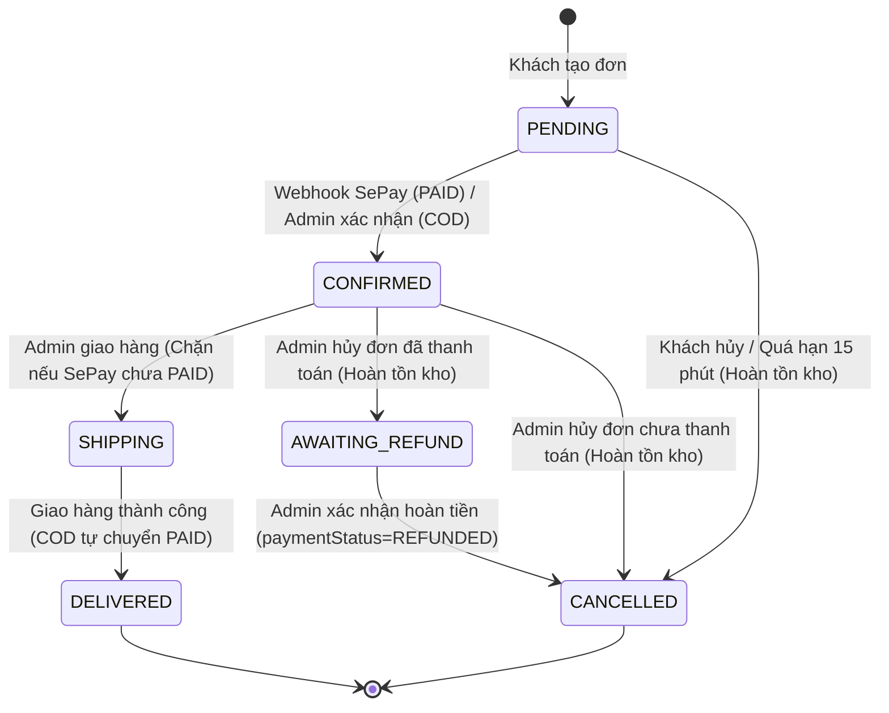

# TÀI LIỆU BÀN GIAO API CHO FRONTEND (ANDROID & NEXT.JS)

> **Dự án**: BE_E-Commerce (Spring Boot 3.3.4, Java 21, MongoDB Atlas, Redis)  
> **Phiên bản API**: `v1`  
> **Base Path**: `/api/v1`  
> **Đối tượng sử dụng**: Mobile Engineer (Android) & Frontend Engineer (Next.js)

---

## 1. QUY CHUẨN GIAO TIẾP VÀ CẤU TRÚC PHẢN HỒI

Mọi API phản hồi đều tuân theo cấu trúc JSON đồng nhất:

### 1.1. Phản hồi thành công (`ApiResponse<T>`)
```json
{
  "code": 1000,
  "message": "Thông điệp thành công",
  "data": { ... }
}
```

### 1.2. Phản hồi phân trang (`PageResponse<T>`)
Khi `data` là dữ liệu danh sách có phân trang:
```json
{
  "code": 1000,
  "message": "Thành công",
  "data": {
    "items": [ ... ],
    "pageNo": 0,
    "pageSize": 15,
    "totalElements": 42,
    "totalPages": 3,
    "last": false
  }
}
```
> [!NOTE]
> - Tham số phân trang gửi lên: `page` (bắt đầu từ `0`) và `size` (mặc định 15, **giới hạn trần cứng [1, 50]** để chống DoS tràn RAM).
> - Backend tự động giới hạn nếu client gửi `size > 50` về `50`, và `page < 0` về `0`.

### 1.3. Phản hồi lỗi (`AppException` / `GlobalExceptionHandler`)
```json
{
  "code": 5004,
  "error": "PAYMENT_METHOD_NOT_SUPPORTED",
  "message": "Phương thức thanh toán ví điện tử MOMO hiện chưa được tích hợp."
}
```

---

## 2. XÁC THỰC, TÀI KHOẢN & OTP (AUTH FLOW)

### 2.1. Luồng Đăng ký & Kích hoạt qua OTP
1. **Đăng ký tài khoản**: `POST /api/v1/auth/register`
   - **Body**:
     ```json
     {
       "email": "customer@gmail.com",
       "password": "Password123@",
       "fullName": "Nguyễn Văn A",
       "phone": "0987654321"
     }
     ```
   - **Cơ chế**: Tài khoản được tạo với trạng thái `isActive = false`. Hệ thống sinh mã OTP 6 chữ số có hiệu lực trong **5 phút** và gửi vào email của người dùng.
   - **Lưu ý**: Nếu tài khoản chưa kích hoạt mà gọi `POST /api/v1/auth/login`, API trả lỗi HTTP 400 (`USER_NOT_ACTIVATED` - mã `1017`).

2. **Xác thực OTP kích hoạt**: `POST /api/v1/auth/verify-account` hoặc `/verify-otp`
   - **Body**:
     ```json
     {
       "email": "customer@gmail.com",
       "otp": "123456"
     }
     ```
   - **Thành công**: Tài khoản chuyển sang `isActive = true`, `emailVerified = true`. Người dùng có thể đăng nhập.
   - **Bảo mật**: Nhập sai quá **5 lần**, mã OTP sẽ bị hủy trên Redis.

3. **Gửi lại OTP**: `POST /api/v1/auth/send-verification-otp`
   - **Body**: `{"email": "customer@gmail.com"}`.
   - **Rate limit**: Tối đa 5 request/phút.

### 2.2. Đăng nhập & Quản lý Token
- **Đăng nhập**: `POST /api/v1/auth/login`
  - **Body**: `{"email": "...", "password": "..."}`
  - **Response**: Trả về `accessToken` (JWT thời hạn ngắn), `refreshToken` (thời hạn 7 ngày, lưu Redis whitelist), thông tin `user`.
- **Làm mới token**: `POST /api/v1/auth/refresh-token`
  - **Body**: `{"refreshToken": "..."}`
- **Đăng xuất**: `POST /api/v1/auth/logout`
  - Thu hồi `refreshToken` khỏi Redis và đưa `accessToken` hiện tại vào blacklist.
- **Quên mật khẩu**:
  - Bước 1: `POST /api/v1/auth/forgot-password` với `{"email": "..."}`.
  - Bước 2: `POST /api/v1/auth/reset-password` với `{"email": "...", "otp": "...", "newPassword": "..."}`. Sau khi reset thành công, toàn bộ refresh token cũ của tài khoản bị thu hồi ngay lập tức.

---

## 3. SẢN PHẨM & DANH MỤC (PRODUCTS & CATEGORIES)

### 3.1. Phía Khách hàng (Public)
- `GET /api/v1/public/products`: Danh sách sản phẩm đang bán (`active: true`), hỗ trợ tìm kiếm từ khóa, khoảng giá, phân loại, thương hiệu.
- `GET /api/v1/public/products/{id}`:
  > [!WARNING]
  > Nếu sản phẩm đã bị Admin ẩn (`active == false`), API trả về **HTTP 404** (`PRODUCT_NOT_FOUND` - mã `3001`). Frontend cần hiển thị thông báo "Sản phẩm không tồn tại hoặc đã ngừng kinh doanh" thay vì để crash.

### 3.2. Phía Quản trị viên (Admin - Yêu cầu Role ADMIN)
- `GET /api/v1/admin/products`: Xem danh sách toàn bộ sản phẩm (kèm cờ lọc `active=true|false`).
- `GET /api/v1/admin/products/{id}`: Xem chi tiết sản phẩm bất kỳ.
- `PATCH /api/v1/admin/products/{id}/status`: Bật/tắt trạng thái ẩn hiện:
  ```json
  { "active": false }
  ```

---

## 4. GIỎ HÀNG, ĐẶT HÀNG & THANH TOÁN (ORDER & PAYMENT)

### 4.1. Lựa chọn phương thức thanh toán khả dụng
Trước khi hiển thị trang thanh toán (Checkout), FE gọi API:
- `GET /api/v1/payment/methods` (hoặc `/api/v1/payments/methods`)
- **Response**:
  ```json
  {
    "code": 1000,
    "message": "Lấy danh sách phương thức thanh toán thành công",
    "data": [
      {
        "code": "COD",
        "name": "Thanh toán khi nhận hàng (COD)",
        "description": "Thanh toán bằng tiền mặt khi nhận hàng",
        "enabled": true
      },
      {
        "code": "SEPAY",
        "name": "Chuyển khoản VietQR tự động qua SePay",
        "description": "Quét mã VietQR chuyển khoản ngân hàng, hệ thống xác nhận thanh toán tự động trong vài giây",
        "enabled": true
      }
    ]
  }
  ```

> [!IMPORTANT]
> **Quyết định D1 đã chốt**: Chỉ hỗ trợ **COD** và **SEPAY**.
> Nếu gửi `MOMO`, `VNPAY` hoặc `BANKING` lên API Checkout, hệ thống sẽ từ chối với lỗi HTTP 400 (`PAYMENT_METHOD_NOT_SUPPORTED` - mã `5004`).

### 4.2. Đặt hàng (Checkout)
- `POST /api/v1/orders`
- **Body**:
  ```json
  {
    "customerName": "Nguyễn Văn A",
    "customerEmail": "customer@gmail.com",
    "customerPhone": "0987654321",
    "shippingAddress": {
      "fullName": "Nguyễn Văn A",
      "phone": "0987654321",
      "province": "Hà Nội",
      "district": "Cầu Giấy",
      "ward": "Dịch Vọng",
      "streetAddress": "Số 123 Cầu Giấy"
    },
    "paymentMethod": "SEPAY",
    "note": "Giao giờ hành chính"
  }
  ```
- **Response**: Trả về `OrderResponse`:
  - `status`: `PENDING`
  - `paymentStatus`: `UNPAID`
  - Nếu `paymentMethod == "SEPAY"`, response trả kèm thông tin VietQR:
    - `qrImageUrl`: Link ảnh VietQR chuẩn SePay (chứa sẵn số tài khoản, số tiền, cú pháp chuyển khoản).
    - `bankName`, `accountNumber`, `accountHolder`, `transferContent` (`orderCode`).

### 4.3. Quản lý Đơn hàng & Cơ chế Đếm ngược Quá hạn (D3, D5, D6)
1. **Thời gian giữ đơn (D3)**:
   - Các đơn hàng `SEPAY` chưa thanh toán (`UNPAID`) có thời hạn thanh toán là **15 phút**.
   - Frontend hiển thị đồng hồ đếm ngược 15 phút. Khi hết hạn, đơn hàng sẽ được backend tự động hủy và hoàn lại số lượng tồn kho (`status: CANCELLED`).
2. **Kiểm tra trạng thái thanh toán**:
   - `GET /api/v1/payment/status/{orderId}`
   - **Response**:
     ```json
     {
       "code": 1000,
       "data": {
         "orderId": "...",
         "orderCode": "BETES12345678",
         "paymentStatus": "PAID",
         "finalAmount": 250000,
         "paidAmount": 250000,
         "amountDiscrepancy": 0,
         "isOverpaid": false,
         "isUnderpaid": false,
         "isPaid": true,
         "isCancelled": false,
         "message": "Đơn hàng đã được thanh toán đầy đủ."
       }
     }
     ```
   - **Khách chuyển thiếu (D5)**: `isUnderpaid = true`, `paymentStatus` vẫn là `UNPAID`. Khách hàng có thể quét mã tiếp tục chuyển phần tiền còn lại trước khi hết 15 phút. Khi tổng số tiền tích lũy đủ `finalAmount`, đơn tự động sang `PAID` và `CONFIRMED`.
   - **Khách chuyển thừa (D6)**: `isOverpaid = true`, `amountDiscrepancy > 0`. Đơn hàng vẫn được duyệt `PAID` và `CONFIRMED` để kịp thời đóng gói, phần tiền thừa được ghi nhận để Admin hoàn tiền thủ công.

### 4.4. Hủy đơn hàng và Hoàn tiền (D4, D7)
1. **Khách hàng tự hủy**: `PUT /api/v1/orders/{id}/cancel` (chỉ được hủy khi `status == PENDING` và `paymentStatus == UNPAID`).
2. **Admin giao hàng (D4)**:
   - Đơn `SEPAY` chưa `PAID` mà Admin bấm chuyển sang `SHIPPING` sẽ bị hệ thống **chặn hoàn toàn** với lỗi HTTP 400 (`PAYMENT_REQUIRED_BEFORE_SHIPPING` - mã `5005`).
3. **Admin hủy đơn đã thanh toán (D7)**:
   - Nếu Admin bấm hủy đơn hàng đã `PAID`, đơn hàng chuyển sang trạng thái `AWAITING_REFUND`, tồn kho lập tức được hoàn lại.
   - Khi Admin đã chuyển khoản hoàn tiền cho khách, Admin gọi API `PATCH /api/v1/admin/orders/{id}/confirm-refund` để hoàn tất chuyển sang `CANCELLED` và `paymentStatus: REFUNDED`.

---

## 5. MÁY TRẠNG THÁI ĐƠN HÀNG (ORDER STATE MACHINE)



---

## 6. QUẢN TRỊ ADMIN APIS (ROLE_ADMIN)

### 6.1. Quản lý Người dùng
- `GET /api/v1/admin/users`: Tìm kiếm theo từ khóa tên/email/sđt, lọc theo `role`, `active`, phân trang.
- `GET /api/v1/admin/users/{userId}`: Chi tiết hồ sơ kèm `totalOrders` và `totalSpent` (chuẩn D9).
- `PATCH /api/v1/admin/users/{userId}/status`: Khóa (`active: false`) hoặc mở khóa (`active: true`).
- `PATCH /api/v1/admin/users/{userId}/roles`: Cập nhật vai trò (`["ROLE_CUSTOMER", "ROLE_ADMIN"]`).

### 6.2. Tra cứu & Chi tiết Đơn hàng
- `GET /api/v1/admin/orders`: Lọc theo `keyword` (mã đơn, sđt, email), `status`, `paymentStatus`, `paymentMethod`, `from`, `to`, `sortBy`, `sortDir`.
- `GET /api/v1/admin/orders/{id}`: Chi tiết đơn hàng kèm toàn bộ lịch sử giao dịch SePay liên quan.

### 6.3. Đối soát Giao dịch SePay
- `GET /api/v1/admin/payments/transactions`: Danh sách giao dịch SePay (lọc theo `status: PROCESSED | MISMATCH | FAILED | DUPLICATE`).
- `PATCH /api/v1/admin/payments/transactions/{id}/process`: Xử lý giao dịch lỗi/lệch tiền thủ công:
  ```json
  {
    "action": "RESOLVED",
    "adminNote": "Đã đối soát thủ công và hoàn tiền mặt cho khách"
  }
  ```

### 6.4. Thống kê & Báo cáo Doanh thu (Chuẩn D9)
- `GET /api/v1/admin/statistics/overview?from=...&to=...`: Tổng quan doanh thu, số đơn, người dùng mới, số sản phẩm sắp hết hàng.
- `GET /api/v1/admin/statistics/revenue?groupBy=day|month&from=...&to=...`: Dữ liệu vẽ biểu đồ doanh thu.
- `GET /api/v1/admin/statistics/top-products?limit=10`: Top sản phẩm bán chạy.
- `GET /api/v1/admin/statistics/low-stock?threshold=10`: Danh sách sản phẩm tồn kho thấp cần nhập thêm hàng.

### 6.5. Upload Đa phương tiện
- `POST /api/v1/media/upload`: Upload 1 ảnh (`file`).
- `POST /api/v1/media/upload-multiple`: Upload nhiều ảnh (`files`).
> [!NOTE]
> Bắt buộc phải có quyền `ROLE_ADMIN` để upload ảnh.

---

## 7. BẢNG MÃ LỖI HỆ THỐNG (ERROR CODES)

| Mã lỗi | Enum Name | HTTP Status | Ý nghĩa & Hướng xử lý trên giao diện |
| :--- | :--- | :---: | :--- |
| `1000` | `SUCCESS` | 200 / 201 | Thao tác thành công. |
| `1001` | `UNAUTHENTICATED` | 401 | Chưa đăng nhập hoặc token đã hết hạn / bị thu hồi -> Chuyển về màn hình đăng nhập. |
| `1002` | `UNAUTHORIZED` / `ACCESS_DENIED` | 403 | Không có quyền truy cập chức năng này (ví dụ: Customer cố gọi API Admin). |
| `1003` | `VALIDATION_ERROR` | 400 | Dữ liệu gửi lên không đúng định dạng (thiếu trường, sai regex, rỗng...). |
| `1004` | `USER_ALREADY_EXISTS` | 409 | Email này đã được đăng ký trong hệ thống. |
| `1005` | `INVALID_CREDENTIALS` | 401 | Email hoặc mật khẩu không chính xác. |
| `1006` | `TOKEN_EXPIRED` | 401 | Access token hết hạn -> Gọi API `refresh-token`. |
| `1007` | `INVALID_TOKEN` | 401 | Token không hợp lệ. |
| `1016` | `INVALID_OTP` | 400 | Mã OTP không đúng hoặc đã hết hạn (quá 5 phút). |
| `1017` | `USER_NOT_ACTIVATED` | 400 | Tài khoản chưa xác thực OTP email -> Chuyển sang màn hình nhập OTP. |
| `1018` | `USER_BLOCKED` | 403 | Tài khoản đã bị khóa bởi Quản trị viên. |
| `3001` | `PRODUCT_NOT_FOUND` | 404 | Không tìm thấy sản phẩm (hoặc sản phẩm đang bị ẩn). |
| `3002` | `INSUFFICIENT_STOCK` | 400 | Sản phẩm không đủ số lượng trong kho khi đặt hàng. |
| `4001` | `ORDER_NOT_FOUND` | 404 | Đơn hàng không tồn tại hoặc không thuộc quyền sở hữu của user (IDOR prevention). |
| `4002` | `ORDER_CANNOT_BE_CANCELLED` | 400 | Đơn hàng không ở trạng thái PENDING/UNPAID để hủy. |
| `4004` | `INVALID_ORDER_STATUS_TRANSITION`| 400 | Chuyển đổi trạng thái đơn hàng không hợp lệ theo quy trình. |
| `4005` | `ORDER_ALREADY_REFUNDED` | 400 | Đơn hàng đã được hoàn tiền trước đó. |
| `5001` | `PAYMENT_FAILED` | 400 | Xử lý thanh toán thất bại. |
| `5004` | `PAYMENT_METHOD_NOT_SUPPORTED` | 400 | Phương thức thanh toán chưa được hỗ trợ (chỉ chấp nhận COD và SEPAY). |
| `5005` | `PAYMENT_REQUIRED_BEFORE_SHIPPING`| 400 | Đơn SEPAY chưa thanh toán (PAID), không thể chuyển sang giao hàng. |
| `9001` | `TOO_MANY_REQUESTS` | 429 | Thao tác quá nhanh, vượt giới hạn Rate Limit (vui lòng thử lại sau 1 phút). |
| `9999` | `INTERNAL_SERVER_ERROR` | 500 | Lỗi hệ thống máy chủ, vui lòng thử lại sau. |
